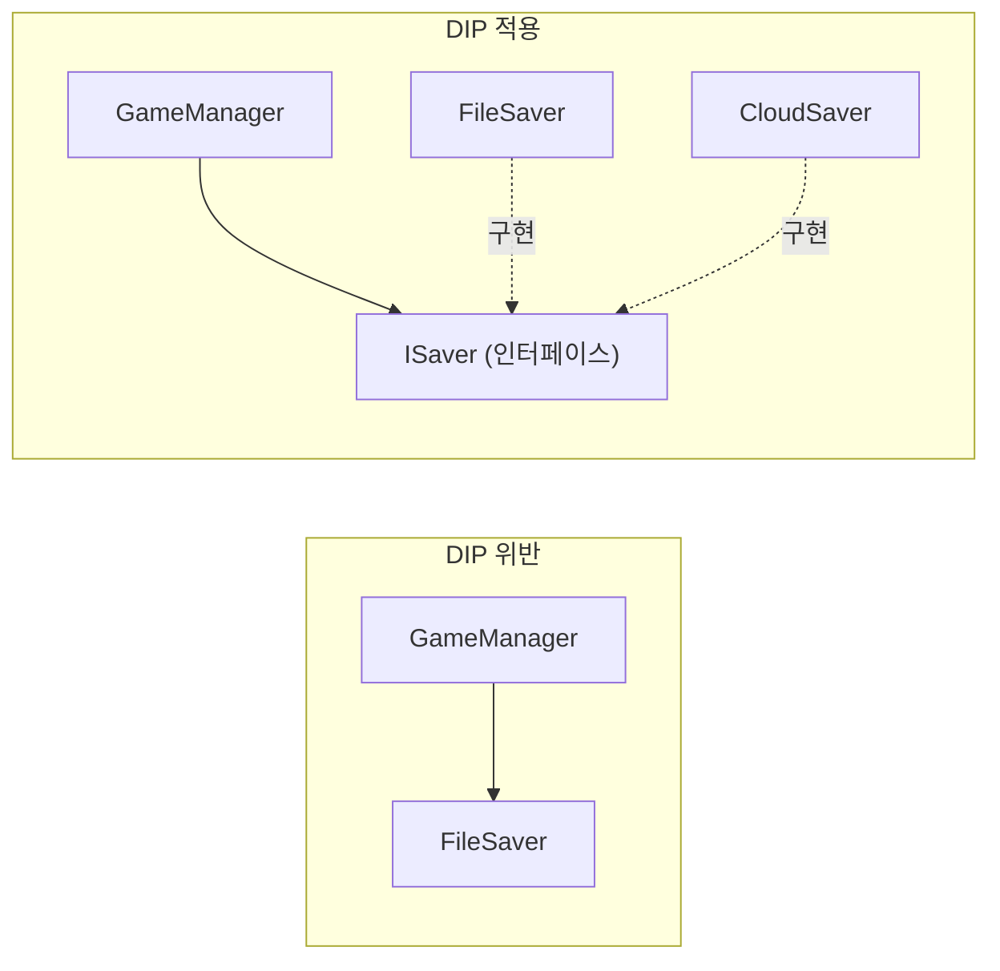
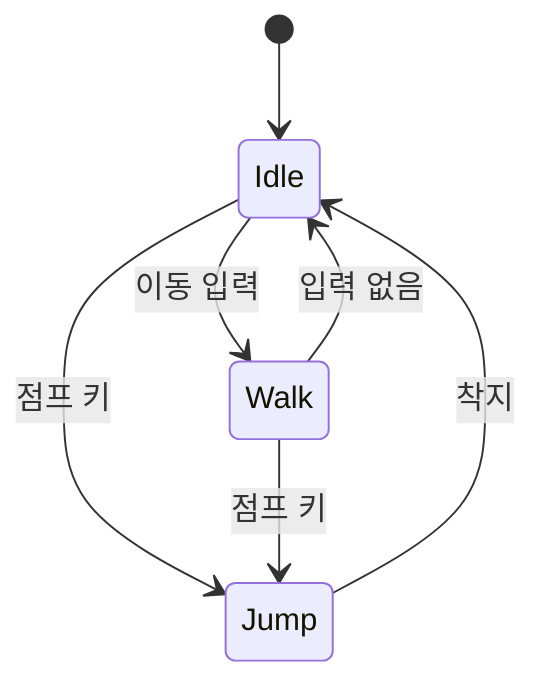
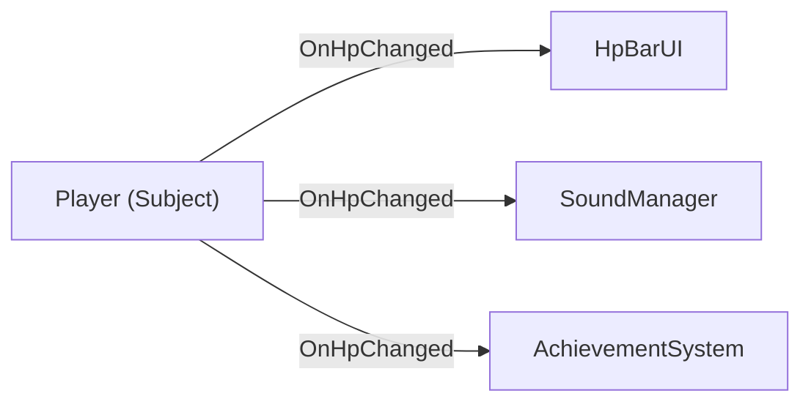
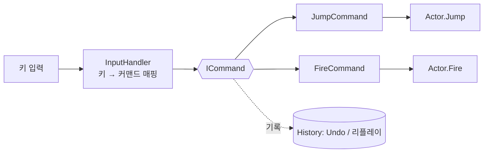
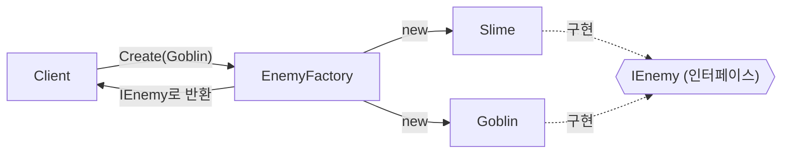

# C# 핵심 키워드 정리

> C# 문법 · 메모리 · 객체지향 · SOLID · 디자인 패턴 키워드 학습 노트
> `(Unity)` 표시는 Unity 엔진에서만 쓰이는 내용

## 1. C# switch when

> `when` = **케이스 가드(case guard)**. 패턴이 일치하고 **추가 조건까지 true**일 때만 해당 case 실행

- 위에서부터 순서대로 검사 → 구체적인 조건을 위에 배치
- switch 문(statement)과 switch 식(expression, C# 8+) 모두 사용 가능

```csharp
object item = 15;

switch (item)
{
    case int n when n > 10:          // 패턴(int) + 조건(n > 10)
        Console.WriteLine($"10보다 큰 정수: {n}");
        break;
    case int n:                      // when 조건에 안 걸린 int
        Console.WriteLine($"정수: {n}");
        break;
    case string s when s.Length == 0:
        Console.WriteLine("빈 문자열");
        break;
    default:
        Console.WriteLine("기타");
        break;
}

// switch 식 (C# 8+)
int score = 85;
string grade = score switch
{
    < 0 or > 100       => "잘못된 점수",
    var s when s >= 90 => "A",
    var s when s >= 80 => "B",
    _                  => "C"
};
```

## 2. C# SOLID 원칙이란?

> 로버트 C. 마틴이 정리한 **객체지향 설계 5원칙**. 변경에 강하고 확장하기 쉬운 코드를 만드는 지침

| 약자 | 원칙 | 한 줄 요약 |
|------|------|-----------|
| **S** | 단일 책임 (SRP) | 클래스는 **하나의 책임**(변경 이유)만 |
| **O** | 개방-폐쇄 (OCP) | **확장에는 열려** 있고 **수정에는 닫혀** 있게 |
| **L** | 리스코프 치환 (LSP) | 자식은 **부모를 대체**할 수 있어야 |
| **I** | 인터페이스 분리 (ISP) | 쓰지 않는 메서드에 의존하지 않도록 **인터페이스를 작게** |
| **D** | 의존성 역전 (DIP) | 구체 클래스가 아닌 **추상화에 의존** |

## 3. C# array2D의 두 가지 종류

```
[직사각형 배열 int[,]]  하나의 연속된 메모리 블록
+---+---+---+
| 1 | 2 | 3 |
+---+---+---+
| 4 | 5 | 6 |
+---+---+---+

[가변형 배열 int[][]]  각 행이 별도의 배열 객체
+---+
| * | ---> [ 1 ]
+---+
| * | ---> [ 2 ][ 3 ]
+---+
| * | ---> [ 4 ][ 5 ][ 6 ]
+---+
```

| 구분 | 직사각형 배열 `int[,]` | 가변형 배열 `int[][]` |
|------|------------------------|------------------------|
| 선언 | `new int[2, 3]` | `new int[3][]` + 행마다 `new` |
| 행 길이 | 모두 동일 | 행마다 다를 수 있음 |
| 접근 | `a[i, j]` | `a[i][j]` |
| 메모리 | 한 덩어리 | 행마다 별도 객체 |
| 크기 확인 | `GetLength(0)`, `GetLength(1)` | `a.Length`, `a[i].Length` |
| 적합한 경우 | 타일맵, 격자처럼 정형 데이터 | 행마다 길이가 다른 데이터 |

> 💡 .NET에서는 1차원 배열 접근이 최적화되어 있어서 가변형 배열이 보통 더 빠른 편

## 4. 단일책임원칙(SRP)

> 한 클래스는 **한 가지 책임**만 가져야 한다 = **변경되어야 할 이유가 하나**뿐이어야 한다

```csharp
// ❌ 이동 + 체력 + 사운드 + 저장을 한 클래스가 전부 담당
class Player
{
    void Move() { }
    void TakeDamage() { }
    void PlaySound() { }
    void SaveToFile() { }
}

// ✅ 책임별로 분리
class PlayerMovement { void Move() { } }
class PlayerHealth   { void TakeDamage() { } }
class PlayerAudio    { void PlaySound() { } }
class SaveSystem     { void Save(PlayerData data) { } }
```

## 5. 지역변수(스택)

> 메서드 안에서 선언된 변수. 선언된 블록 `{ }` 안에서만 유효(**스코프**)

- **스택(Stack)**: LIFO 구조. 메서드 호출 시 스택 프레임이 생기고, 메서드가 끝나면 **자동 해제**
- 할당·해제가 매우 빠르지만 크기가 제한적 → 너무 깊은 재귀는 `StackOverflowException`
- 값 형식 지역변수는 **값 자체**가, 참조 형식 지역변수는 **참조(주소)만** 스택에 저장
- ⚠️ 람다에 캡처되거나 `async`/반복기(`yield`) 안의 지역변수는 힙으로 옮겨질 수 있음

```csharp
void Foo()
{
    int a = 10;          // 스택에 저장
    if (a > 5)
    {
        int b = 20;      // 이 블록 { } 안에서만 유효
    }
    // Console.WriteLine(b);  ❌ 스코프 밖이라 에러
}   // Foo 종료 → 스택 프레임 통째로 해제
```

## 6. 개방폐쇄원칙(OCP)

> 새 기능을 추가할 때 **기존 코드를 수정하지 않고**, 새 코드를 **추가(확장)** 해서 해결

- 보통 **인터페이스/추상 클래스 + 다형성**으로 달성

```csharp
// ❌ 무기가 추가될 때마다 이 switch를 수정해야 함
float GetDamage(string weapon) => weapon switch
{
    "Sword" => 10,
    "Bow"   => 7,
    _       => 0
};
```

```csharp
// ✅ 새 무기 = 새 클래스 추가만 하면 끝
interface IWeapon { float Damage { get; } }

class Sword : IWeapon { public float Damage => 10; }
class Bow   : IWeapon { public float Damage => 7; }
class Axe   : IWeapon { public float Damage => 12; }   // 기존 코드 수정 없음

float GetDamage(IWeapon weapon) => weapon.Damage;
```

## 7. 동적할당(힙)

> `new`로 **실행 중(런타임)에** 메모리를 할당하는 것. 참조 형식 객체(클래스 인스턴스, 배열, string)는 힙에 생성

- 해제는 **GC(가비지 컬렉터)** 가 자동으로 처리 → 아무도 참조하지 않는 객체를 수거
- 수명이 메서드에 묶이지 않음, 큰 데이터 저장 가능
- 단점: 할당 + GC 비용. `(Unity)` `Update()`에서 `new`를 남발하면 GC 스파이크로 프레임 끊김 → **오브젝트 풀링**으로 재사용

```csharp
int[] arr = new int[1000];   // 배열 본체는 힙, arr(참조)는 스택
Player p = new Player();     // Player 객체는 힙
p = null;                    // 참조가 끊김 → 이후 GC 수거 대상
```

| 구분 | 스택 | 힙 |
|------|------|-----|
| 저장 대상 | 값 형식 지역변수, 매개변수, 참조(주소) | `new`로 만든 참조 형식 객체 |
| 해제 | 스코프 종료 시 자동 | GC가 수거 |
| 속도 | 매우 빠름 | 상대적으로 느림 (할당 + GC) |
| 크기 | 작음 | 큼 |

## 8. 리스코프 치환원칙(LSP)

> 부모 타입 자리에 **자식 객체를 넣어도 프로그램이 올바르게 동작**해야 한다

- 자식이 부모의 약속(동작 규약)을 깨면 안 됨 → "is-a" 관계가 문법뿐 아니라 **행동**까지 성립해야 함

```csharp
// ❌ 위반: 펭귄은 Bird지만 날 수 없음
class Bird { public virtual void Fly() { } }

class Penguin : Bird
{
    public override void Fly() => throw new NotSupportedException();
}

void MakeFly(Bird b) => b.Fly();   // Penguin이 들어오면 예외 → 부모를 대체 못 함
```

```csharp
// ✅ 해결: '날 수 있음'을 별도 능력으로 분리
class Bird { }
interface IFlyable { void Fly(); }

class Sparrow : Bird, IFlyable { public void Fly() { } }
class Penguin : Bird { }           // 날지 못하는 새는 IFlyable을 구현하지 않음
```

## 9. 함수

> 특정 작업을 묶어 이름을 붙인 코드 블록. C#에서는 클래스(또는 구조체) 안에 정의하므로 **메서드(Method)** 라고 부름

- 구조: `[접근제한자] [반환형] 이름(매개변수) { 본문 }`
- 장점: 코드 재사용, 가독성, 유지보수

```csharp
public int Add(int a, int b)
{
    return a + b;
}

// 식 본문(expression-bodied) 메서드: 한 줄짜리는 => 로 간단히
public int Mul(int a, int b) => a * b;
```

## 10. C# 인터페이스 분리(ISP)

> 클라이언트는 **자신이 사용하지 않는 메서드에 의존하면 안 된다** → 큰 인터페이스를 역할별로 작게 나누기

```csharp
// ❌ 뚱뚱한 인터페이스: 나무 상자는 이동·공격이 필요 없는데도 구현을 강요받음
interface IUnit
{
    void Move();
    void Attack();
    void TakeDamage(int dmg);
}
```

```csharp
// ✅ 역할별로 분리 → 필요한 것만 골라 구현
interface IMovable    { void Move(); }
interface IAttackable { void Attack(); }
interface IDamageable { void TakeDamage(int dmg); }

class Soldier : IMovable, IAttackable, IDamageable { /* 셋 다 구현 */ }
class WoodenBox : IDamageable
{
    public void TakeDamage(int dmg) { /* 부서짐 */ }
}
```

## 11. C# 함수의 파라미터와 리턴

> **파라미터(매개변수)** = 함수가 받는 입력 / **인수(argument)** = 호출할 때 실제로 넘기는 값 / **리턴** = 함수의 결과값

- 반환값이 없으면 `void`
- 여러 값을 반환하려면 **튜플** 또는 **out** 사용
- 기본 전달 방식은 **값 전달(call by value)**
  - 값 형식 → 값이 복사됨 (원본 영향 X)
  - 참조 형식 → 참조(주소)가 복사됨 → 객체 **내용 수정은 원본에 반영**, 변수 자체를 새 객체로 바꾸는 건 반영 X

```csharp
void PrintHello() { Console.WriteLine("Hello"); }   // 반환 없음
int Square(int x) { return x * x; }                 // int 반환

// 튜플로 여러 값 반환 (using System.Linq 필요)
(int min, int max) GetRange(int[] arr) => (arr.Min(), arr.Max());

var (min, max) = GetRange(new[] { 3, 1, 4 });       // min = 1, max = 4
```

## 12. C# 의존성 역전(DIP)

> 상위 모듈(정책)이 하위 모듈(구현)에 직접 의존하지 말고, **둘 다 추상화(인터페이스)에 의존**해야 한다



```csharp
// ❌ GameManager가 구체 클래스 FileSaver에 직접 의존
//    → 저장 방식을 바꾸려면 GameManager를 수정해야 함
class FileSaver { public void Save(string data) { } }

class GameManager
{
    private FileSaver saver = new FileSaver();
}
```

```csharp
// ✅ 인터페이스에 의존 → 구현체는 바깥에서 결정
interface ISaver { void Save(string data); }

class FileSaver  : ISaver { public void Save(string data) { /* 파일에 저장 */ } }
class CloudSaver : ISaver { public void Save(string data) { /* 서버에 저장 */ } }

class GameManager
{
    private readonly ISaver saver;
    public GameManager(ISaver saver) => this.saver = saver;   // 외부에서 주입 (DI)
}
```

## 13. C# 디폴트 파라미터

> 매개변수에 **기본값**을 지정해두면 호출 시 생략 가능 (선택적 매개변수)

- 기본값이 있는 매개변수는 **맨 뒤쪽**에 위치해야 함
- 기본값은 **컴파일 타임 상수**만 가능 (리터럴, `const`, `default` 등)
- **명명된 인수**(`이름: 값`)와 함께 쓰면 중간 값만 골라서 지정 가능

```csharp
void Spawn(string name, int hp = 100, float speed = 1.5f) { /* ... */ }

Spawn("Slime");              // hp = 100, speed = 1.5
Spawn("Orc", 200);           // speed = 1.5
Spawn("Bat", speed: 3f);     // 명명된 인수로 hp는 건너뜀
```

## 14. C# 의존성 주입(DI)

> 객체가 필요로 하는 다른 객체(**의존성**)를 내부에서 `new`로 만들지 않고 **외부에서 넣어주는** 기법

- **DIP = 설계 원칙(무엇을)**, **DI = 그걸 실현하는 구현 기법(어떻게)**
- 장점: 결합도 ↓, 구현 교체 쉬움, 테스트 시 가짜(Mock) 객체 주입 가능

| 방식 | 설명 |
|------|------|
| 생성자 주입 | 생성자 매개변수로 받음 (가장 권장, 필수 의존성) |
| 프로퍼티(세터) 주입 | 프로퍼티에 대입 (선택적 의존성) |
| 메서드 주입 | 메서드 호출 시 매개변수로 전달 |

```csharp
// 1) 생성자 주입
public class Enemy
{
    private readonly IWeapon weapon;
    public Enemy(IWeapon weapon) => this.weapon = weapon;
}

// 2) 프로퍼티 주입
public class Enemy2
{
    public IWeapon Weapon { get; set; }
}

// 3) 메서드 주입
public class Enemy3
{
    public void Attack(IWeapon weapon) { /* weapon 사용 */ }
}

// 조립하는 쪽에서 무엇을 넣을지 결정
var enemy = new Enemy(new Sword());
```

> `(Unity)` MonoBehaviour는 생성자를 쓸 수 없으므로 인스펙터 할당(`[SerializeField]`), `Init()` 메서드, 또는 VContainer·Zenject 같은 DI 프레임워크를 사용

## 15. C# 함수 파라미터(out)

> 메서드가 **결과를 내보내는 용도**의 매개변수. 주로 **여러 값을 반환**할 때 사용

- 호출 전 초기화 **불필요**
- 메서드 안에서 반드시 값을 **할당해야** 함
- 대표 예: `int.TryParse`, `Dictionary.TryGetValue` (Try 패턴)

```csharp
bool TryDivide(int a, int b, out int result)
{
    if (b == 0) { result = 0; return false; }
    result = a / b;
    return true;
}

if (TryDivide(10, 2, out int r))
    Console.WriteLine(r);            // 5

int.TryParse("123", out int num);    // 호출하면서 바로 변수 선언 가능
```

## 16. C# 싱글톤 패턴

> 클래스의 인스턴스가 **단 하나만** 존재하도록 보장하고, **어디서든 접근**할 수 있는 전역 접근점 제공

- 용도: `GameManager`, `AudioManager`처럼 하나만 있어야 하는 관리자

```csharp
// 순수 C#
public class GameManager
{
    private static GameManager instance;
    public static GameManager Instance => instance ??= new GameManager();
    // 멀티스레드 환경이면 Lazy<GameManager> 사용

    private GameManager() { }      // 외부에서 new 금지
    public int Score { get; set; }
}

GameManager.Instance.Score += 10;  // 어디서든 접근
```

```csharp
// (Unity) MonoBehaviour 싱글톤
public class GameManager : MonoBehaviour
{
    public static GameManager Instance { get; private set; }

    private void Awake()
    {
        if (Instance != null && Instance != this)
        {
            Destroy(gameObject);           // 중복 생성 방지
            return;
        }
        Instance = this;
        DontDestroyOnLoad(gameObject);     // 씬이 바뀌어도 유지
    }
}
```

## 17. C# 함수 파라미터(ref)

> 변수의 **참조(주소)** 를 넘겨서 메서드 안에서 **원본을 직접 수정**

- 호출 전 반드시 **초기화** 필요
- 선언부와 호출부 **양쪽에 `ref`** 를 붙여야 함

```csharp
void Swap(ref int a, ref int b)
{
    int temp = a;
    a = b;
    b = temp;
}

int x = 1, y = 2;
Swap(ref x, ref y);   // x = 2, y = 1 (원본이 바뀜)
```

### ref vs out vs in

| 구분 | `ref` | `out` | `in` |
|------|-------|-------|------|
| 호출 전 초기화 | 필수 | 불필요 | 필수 |
| 메서드 안에서 값 할당 | 선택 | **필수** | **불가** (읽기 전용) |
| 주 용도 | 원본 수정 | 여러 값 반환 | 큰 struct를 복사 없이 읽기 전용으로 전달 |

## 18. C# 싱글톤 패턴의 문제점

| 문제 | 설명 |
|------|------|
| 전역 상태 | 어디서든 값을 바꿀 수 있어 버그 추적이 어려움 |
| 강한 결합 | `Instance`를 직접 호출 → 의존성이 코드 속에 숨음 (DIP 위반) |
| 테스트 어려움 | 가짜 객체로 교체 불가, 테스트끼리 상태가 공유됨 |
| SRP 위반 | 본래 역할 + 자기 인스턴스 생명주기 관리까지 담당 |
| 초기화 순서 | `(Unity)` `Awake` 실행 순서에 따라 `Instance`가 아직 `null`일 수 있음 |
| 멀티스레드 | 동시에 생성되면 인스턴스가 2개 생길 위험 (`lock`/`Lazy<T>` 필요) |
| 남용 | 모든 걸 매니저에 넣다 보면 거대한 "만능 클래스"가 됨 |

> 💡 대안: **의존성 주입(DI)**, `(Unity)` ScriptableObject 기반 공유 데이터, 서비스 로케이터

## 19. C# 배열

> **같은 타입**의 데이터를 **연속된 메모리**에 저장하는 자료구조. 인덱스는 0부터, **크기 고정**

- 배열 자체는 참조 형식 (힙에 생성)
- 범위를 벗어나면 `IndexOutOfRangeException`

```csharp
int[] a = new int[3];            // {0, 0, 0} — 기본값으로 초기화
int[] b = { 1, 2, 3 };
int[] c = new int[] { 1, 2, 3 };
int[] d = [1, 2, 3];             // 컬렉션 식 (C# 12+)

Console.WriteLine(b.Length);     // 3
foreach (int n in b)
    Console.Write(n);            // 123
```

## 20. C# 컴포넌트 패턴

> 하나의 객체가 가진 여러 기능을 **독립적인 컴포넌트(부품)** 로 쪼개고 **조합**해서 사용 — "상속보다 조합"

- Unity의 **GameObject + MonoBehaviour** 구조가 대표적인 예
- 컴포넌트끼리 서로 몰라도 됨 → 재사용성 ↑, 결합도 ↓

| 상속 방식 | 컴포넌트 방식 |
|-----------|---------------|
| `Player : AttackUnit : MoveUnit : Unit` | `Player` = Movement + Health + Attack |
| 기능 조합이 바뀔 때마다 새 클래스 필요 (날아다니는 몬스터? 공격 못 하는 NPC?) | 필요한 컴포넌트만 붙였다 뗐다 |

```csharp
// 각 기능을 독립 컴포넌트로
public class Health : MonoBehaviour
{
    public int hp = 100;
    public void TakeDamage(int dmg) => hp -= dmg;
}

public class Movement : MonoBehaviour
{
    public float speed = 5f;
    void Update() => transform.Translate(Vector3.forward * speed * Time.deltaTime);
}

// 다른 컴포넌트는 필요할 때 찾아서 사용
public class Trap : MonoBehaviour
{
    void OnTriggerEnter(Collider other)
    {
        if (other.TryGetComponent(out Health health))
            health.TakeDamage(10);
    }
}
```

## 21. C# 2차원 배열

> 행과 열로 이루어진 **직사각형 배열** `int[,]`. 모든 행의 길이가 같음

```csharp
int[,] grid =
{
    { 1, 2, 3 },
    { 4, 5, 6 }
};

Console.WriteLine(grid[1, 2]);   // 6
int rows = grid.GetLength(0);    // 2 (행)
int cols = grid.GetLength(1);    // 3 (열)
// grid.Length → 6 (전체 요소 개수)

for (int i = 0; i < rows; i++)
    for (int j = 0; j < cols; j++)
        Console.Write(grid[i, j]);
```

## 22. C# 상태 패턴

> 객체의 **내부 상태에 따라 동작이 바뀔 때**, 각 상태를 **별도 클래스**로 분리하는 패턴

- FSM을 enum + switch로 구현하면(→ FSM 항목 예제) 상태가 늘어날수록 switch가 비대해짐 → 상태 패턴으로 분리
- 각 상태는 `Enter`(진입) / `Update`(유지) / `Exit`(이탈)을 가짐
- 새 상태 추가 = 새 클래스 추가 (OCP)

```csharp
public interface IState
{
    void Enter();
    void Update();
    void Exit();
}

public class IdleState : IState
{
    private readonly Player player;
    public IdleState(Player player) => this.player = player;

    public void Enter() => Console.WriteLine("대기 시작");
    public void Update()
    {
        if (player.IsMoveInput)
            player.ChangeState(new WalkState(player));   // 상태가 스스로 전이
    }
    public void Exit() => Console.WriteLine("대기 종료");
}
// WalkState, JumpState도 같은 방식으로 구현

public class Player
{
    private IState currentState;
    public bool IsMoveInput;

    public void ChangeState(IState next)
    {
        currentState?.Exit();
        currentState = next;
        currentState.Enter();
    }

    public void Update() => currentState?.Update();
}
```

## 23. C# 2차원 가변형 배열

> **배열의 배열** `int[][]` (Jagged Array). 행마다 길이가 다를 수 있음

- 행 배열을 **각각 `new`로 생성**해야 함

```csharp
int[][] jagged = new int[3][];   // 행 3개 (아직 각 행은 null)
jagged[0] = new int[] { 1 };
jagged[1] = new int[] { 2, 3 };
jagged[2] = new int[] { 4, 5, 6 };

Console.WriteLine(jagged[2][1]);      // 5
Console.WriteLine(jagged.Length);     // 3 (행 개수)
Console.WriteLine(jagged[2].Length);  // 3 (2번 행의 길이)

for (int i = 0; i < jagged.Length; i++)
    for (int j = 0; j < jagged[i].Length; j++)
        Console.Write(jagged[i][j]);
```

## 24. C# FSM

> **Finite State Machine**. 유한한 개수의 상태 중 **한 번에 하나의 상태**에만 있고, 조건(이벤트)에 따라 다른 상태로 **전이(Transition)**

- 구성: **상태(State)**, **전이(Transition)**, **조건/이벤트**, **현재 상태**
- FSM은 **개념(모델)**, 상태 패턴은 그것을 **객체지향으로 구현하는 방법** 중 하나
- `(Unity)` Animator Controller가 FSM의 대표적인 예



```csharp
// 가장 단순한 FSM 구현: enum + switch
enum State { Idle, Walk, Jump }
State current = State.Idle;

void Update()
{
    switch (current)
    {
        case State.Idle:
            if (moveInput) current = State.Walk;
            if (jumpInput) current = State.Jump;
            break;
        case State.Walk:
            if (!moveInput) current = State.Idle;
            if (jumpInput)  current = State.Jump;
            break;
        case State.Jump:
            if (isGrounded) current = State.Idle;
            break;
    }
}
```

## 25. C# ByteStream

> 데이터를 **byte 단위의 연속된 흐름(stream)** 으로 읽고 쓰는 방식. 파일 저장, 네트워크 패킷, 직렬화에 사용

- .NET 표준에 `ByteStream`이라는 클래스는 없음 → `Stream` 계열(`MemoryStream`, `FileStream`, `NetworkStream`) + `BinaryWriter` / `BinaryReader`로 다룸
- 강의에서 직접 만든 `ByteStream` 클래스라면 보통 **`byte[]` 버퍼 + 현재 읽기/쓰기 위치(offset)** 를 관리하는 직렬화 도우미
- ⚠️ **쓴 순서 그대로 읽어야** 데이터가 깨지지 않음

```csharp
using System.IO;

// 쓰기: 데이터 → byte[]
byte[] data;
using (var ms = new MemoryStream())
using (var writer = new BinaryWriter(ms))
{
    writer.Write(100);      // int    → 4바이트
    writer.Write(3.5f);     // float  → 4바이트
    writer.Write("Hero");   // string → 길이 + 내용
    writer.Flush();
    data = ms.ToArray();    // 전송/저장 가능한 바이트 배열
}

// 읽기: byte[] → 데이터 (쓴 순서와 동일하게)
using (var reader = new BinaryReader(new MemoryStream(data)))
{
    int hp      = reader.ReadInt32();
    float speed = reader.ReadSingle();
    string name = reader.ReadString();
}

// 단일 값 변환은 BitConverter로도 가능
byte[] bytes = BitConverter.GetBytes(100);
int value = BitConverter.ToInt32(bytes, 0);
```

## 26. C# 확장 메서드

> 기존 타입(수정할 수 없는 `string`, Unity의 `Transform` 등)에 메서드를 **추가한 것처럼** 쓰는 문법

- 조건: **static class** 안의 **static 메서드** + 첫 매개변수에 **`this 타입`**
- LINQ의 `Where`, `Select`도 확장 메서드

```csharp
public static class StringExtensions
{
    public static string Repeat(this string s, int count)
        => string.Concat(Enumerable.Repeat(s, count));
}

"ab".Repeat(3);   // "ababab" — 인스턴스 메서드처럼 호출
```

```csharp
// (Unity) Transform 확장
public static class TransformExtensions
{
    public static void ResetLocal(this Transform t)
    {
        t.localPosition = Vector3.zero;
        t.localRotation = Quaternion.identity;
        t.localScale = Vector3.one;
    }
}

// 사용: transform.ResetLocal();
```

## 27. C# 구조체

> **값 형식**의 사용자 정의 타입. 좌표, 색상처럼 **작은 데이터 묶음**에 적합

- 상속 불가 (인터페이스 구현은 가능)
- 대입·전달 시 **전체가 복사**됨

```csharp
public struct Point
{
    public int X;
    public int Y;

    public Point(int x, int y) { X = x; Y = y; }
}

Point a = new Point(1, 2);
Point b = a;        // 값 전체 복사
b.X = 99;
Console.WriteLine(a.X);   // 1 (원본 그대로)
```

```csharp
// (Unity) Vector3는 구조체 → transform.position은 '복사본'을 반환
transform.position.x = 5f;          // ❌ 컴파일 에러 (CS1612)

Vector3 pos = transform.position;   // 복사본을 꺼내서
pos.x = 5f;                         // 수정한 뒤
transform.position = pos;           // 통째로 다시 대입 ✅
```

## 28. C# Static Class

> **인스턴스를 만들 수 없고**, `static` 멤버만 가지는 클래스

- `new` 불가, 상속 불가 (자동으로 `sealed`)
- `클래스명.멤버`로 바로 접근, 프로그램 전체에서 하나만 존재
- 용도: 상태가 필요 없는 **유틸리티 함수 모음** (예: `Math`, `Console`)
- 싱글톤과 달리 인터페이스 구현·매개변수 전달·교체가 불가능

```csharp
public static class MathUtil
{
    public const float Pi = 3.14159f;
    public static int Square(int x) => x * x;
}

int r = MathUtil.Square(5);   // new 없이 바로 사용
// new MathUtil();            // ❌ 에러
```

## 29. C# 값 형식

> 변수에 **데이터 자체**를 저장. 대입하면 **값이 통째로 복사**됨

- 종류: `int`, `float`, `double`, `bool`, `char`, `enum`, `struct` (예: `DateTime`, `Vector3`)
- `null` 불가 → `int?` (`Nullable<int>`)로 null 허용 가능

```csharp
int a = 10;
int b = a;      // 값 복사
b = 20;
Console.WriteLine(a);   // 10 (원본 그대로)
```

## 30. `Span<T>`

> 연속된 메모리(배열, `stackalloc`, 문자열 등)의 일부를 **복사 없이** 가리키는 "창(view)"

- `ref struct` → **스택에서만 존재**
  - 클래스 필드로 저장 ❌, 박싱 ❌, 람다 캡처 ❌, `await`를 넘어서 사용 ❌
- 용도: 힙 할당(GC) 없는 고성능 슬라이싱, 파싱, 버퍼 처리

```csharp
int[] arr = { 1, 2, 3, 4, 5 };
Span<int> slice = arr.AsSpan(1, 3);    // {2, 3, 4} — 복사 없음
slice[0] = 99;
Console.WriteLine(arr[1]);             // 99 (원본이 바뀜)

Span<byte> buffer = stackalloc byte[16];   // 힙 할당 없이 스택에 버퍼

ReadOnlySpan<char> text = "Hello World".AsSpan();
ReadOnlySpan<char> word = text.Slice(6);   // "World" — Substring과 달리 새 문자열 X
```

## 31. 참조 형식

> 변수에 객체가 있는 **힙의 주소(참조)** 를 저장. 대입하면 **참조가 복사**되어 같은 객체를 가리킴

- 종류: `class`, `string`, 배열, `interface`, `delegate`, `record`
- `null` 가능 (아무 객체도 가리키지 않음)
- `string`은 참조 형식이지만 **불변(immutable)** 이라 값 형식처럼 동작

```csharp
class Box { public int Value; }

Box a = new Box { Value = 10 };
Box b = a;      // 참조 복사 → 같은 객체
b.Value = 20;
Console.WriteLine(a.Value);   // 20 (원본도 바뀜)
```

## 32. `Memory<T>`

> `Span<T>`처럼 연속된 메모리를 가리키지만 **일반 struct**라서 **힙에 저장 가능**

- 클래스 필드, 컬렉션, `async` 메서드에서 사용 가능
- 실제로 데이터를 다룰 때는 `.Span`으로 변환해서 사용

```csharp
class Packet
{
    public Memory<byte> Payload;       // Span<byte>는 필드 불가, Memory는 가능
}

async Task ProcessAsync(Memory<byte> data)
{
    await Task.Delay(100);             // await를 넘어서도 사용 가능
    Span<byte> span = data.Span;       // 처리할 때는 Span으로
    span[0] = 0xFF;
}
```

| 구분 | `Span<T>` | `Memory<T>` |
|------|-----------|-------------|
| 종류 | `ref struct` | `struct` |
| 저장 위치 | 스택에서만 | 힙에도 저장 가능 |
| 클래스 필드 | ❌ | ✅ |
| `await` 넘어 사용 / 람다 캡처 | ❌ | ✅ |
| `stackalloc` 메모리 | ✅ | ❌ |
| 성능 | 더 빠름 | 약간의 오버헤드 |

> 💡 **동기 메서드 안에서 잠깐 쓸 때 → `Span<T>`**, **저장하거나 비동기로 넘길 때 → `Memory<T>`**

## 33. 값 형식 vs 참조 형식

```
           STACK                            HEAP
  +---------------------+
  | int a = 10          |   <- 값 자체를 저장
  | int b = 10          |   <- b = a : 값 복사 (서로 독립)
  +---------------------+         +------------------+
  | Box x  -------------+-------> | Box { Value=20 } |
  | Box y  -------------+-------> |                  |
  +---------------------+         +------------------+
                         y = x : 주소만 복사 (같은 객체 공유)
```

| 구분 | 값 형식 | 참조 형식 |
|------|---------|-----------|
| 저장 내용 | 데이터 자체 | 데이터의 주소(참조) |
| 저장 위치 | 지역변수면 스택 (객체의 필드면 그 객체 안 = 힙) | 객체 본체는 힙 |
| 대입 `=` | 값 복사 | 참조 복사 (같은 객체 공유) |
| `null` | 불가 (`int?`로 가능) | 가능 |
| 기본값 | `0`, `false` 등 | `null` |
| 예시 | `int`, `float`, `bool`, `enum`, `struct` | `class`, `string`, 배열, `interface`, `delegate` |

> 💡 **박싱(Boxing)**: 값 형식을 `object`(참조 형식)로 변환하면 힙에 복사본이 생김 → 잦으면 성능 저하

## 34. 속성(Attribute)

> 클래스·메서드·필드 등에 붙이는 **메타데이터(부가 정보) 태그**. `[이름(인자)]` 형태

- 코드 동작을 직접 바꾸기보다 **컴파일러, 엔진, 리플렉션**이 읽어서 활용
- 실제 이름은 `XxxAttribute` 클래스이며, `Attribute` 접미사는 생략 가능
- `Attribute` 클래스를 상속해 **커스텀 속성**도 만들 수 있음

```csharp
[AttributeUsage(AttributeTargets.Method)]
public class CheatAttribute : Attribute
{
    public string Description { get; }
    public CheatAttribute(string desc) => Description = desc;
}

[Cheat("체력 전부 회복")]
void HealAll() { }

// 리플렉션으로 읽기: method.GetCustomAttribute<CheatAttribute>()
```

## 35. 클래스

> 데이터(**필드**)와 동작(**메서드**)을 묶은 **설계도**. `new`로 객체(인스턴스)를 만들어 사용

- 참조 형식 (힙에 생성), 상속 가능
- **생성자**: 객체가 만들어질 때 실행되어 초기화 담당

```csharp
public class Player
{
    // 필드
    private string name;
    private int hp;

    // 생성자
    public Player(string name, int hp)
    {
        this.name = name;
        this.hp = hp;
    }

    // 메서드
    public void TakeDamage(int dmg) => hp -= dmg;
}

Player p = new Player("Hero", 100);   // 인스턴스 생성 (힙)
p.TakeDamage(10);
```

## 36. `[Serializable]`

> 클래스/구조체를 **직렬화 가능**하다고 표시 (객체 → 저장·전송 가능한 형태로 변환)

- `(Unity)` 직접 만든 클래스를 **인스펙터에 표시**하거나 `JsonUtility`로 저장하려면 필요
- 일반 .NET에서 이 속성을 쓰던 `BinaryFormatter`는 보안 문제로 사용 중단됨

```csharp
[System.Serializable]
public class ItemData
{
    public string itemName;
    public int price;
}

public class Inventory : MonoBehaviour
{
    public List<ItemData> items;   // [Serializable] 덕분에 인스펙터에 표시
}
```

## 37. 구조체 vs 클래스

| 구분 | 구조체 `struct` | 클래스 `class` |
|------|-----------------|----------------|
| 형식 | 값 형식 | 참조 형식 |
| 메모리 | 지역변수면 스택 (객체 필드면 그 객체 안) | 힙 |
| 대입 / 전달 | 전체 복사 | 참조 복사 |
| 상속 | ❌ (인터페이스 구현은 ✅) | ✅ |
| `null` | ❌ | ✅ |
| GC 부담 | 적음 | 있음 |
| 적합한 경우 | 작고(약 16바이트 이하) 잘 안 바뀌는 데이터 | 크거나, 상태가 자주 바뀌거나, 상속이 필요한 객체 |

## 38. `[Header]`

> `(Unity)` 인스펙터에서 필드 위에 **굵은 제목**을 표시 → 변수 정리용 (동작에는 영향 없음)

- 함께 자주 쓰는 속성: `[Tooltip]`, `[Space]`, `[Range]`, `[SerializeField]`

```csharp
public class PlayerStats : MonoBehaviour
{
    [Header("기본 능력치")]
    public int hp = 100;
    public int mp = 50;

    [Header("이동")]
    [SerializeField] private float moveSpeed = 5f;
    [Tooltip("점프 높이(m)")] public float jumpPower = 2f;

    [Space(10)]
    [Range(0f, 1f)] public float critRate = 0.1f;   // 슬라이더로 표시
}
```

## 39. private, public

> **접근 제한자**: 클래스 멤버에 **누가 접근할 수 있는지** 결정 → **캡슐화**의 핵심

| 제한자 | 접근 가능 범위 |
|--------|---------------|
| `public` | 어디서든 |
| `private` | 선언한 클래스 내부만 (**클래스 멤버의 기본값**) |
| `protected` | 해당 클래스 + 상속받은 자식 클래스 |
| `internal` | 같은 어셈블리(프로젝트) 안 (**클래스 자체의 기본값**) |

- 원칙: 필드는 `private`으로 숨기고, 필요한 기능만 `public` 메서드/프로퍼티로 공개
- `(Unity)` `[SerializeField] private` → 외부 코드에서는 숨기고 인스펙터에만 노출

```csharp
public class Account
{
    private int balance;                // 외부에서 직접 수정 불가

    public void Deposit(int amount)     // 공개된 통로로만 변경 → 검증 가능
    {
        if (amount > 0) balance += amount;
    }
}
```

## 40. `[Obsolete]`

> **더 이상 쓰지 말아야 할 코드**를 표시 → 사용하면 컴파일러가 경고 또는 에러

```csharp
[Obsolete("Move(Vector3)를 사용하세요.")]              // 경고
public void MoveOld(float x, float y) { }

[Obsolete("삭제 예정. Move(Vector3)를 사용하세요.", true)]   // true → 컴파일 에러
public void MoveLegacy() { }
```

## 41. Overloading

> **같은 이름**의 메서드를 **매개변수의 개수·타입·순서를 다르게** 해서 여러 개 정의

- 반환형만 다른 건 오버로딩 ❌
- 어떤 메서드를 호출할지 **컴파일 시점**에 결정

```csharp
int Add(int a, int b) => a + b;
double Add(double a, double b) => a + b;
int Add(int a, int b, int c) => a + b + c;

Add(1, 2);       // int 버전
Add(1.5, 2.5);   // double 버전
Add(1, 2, 3);    // 매개변수 3개 버전
```

## 42. 옵저버 패턴(Observer)

> 한 객체(**Subject**)의 상태가 바뀌면, 이를 **구독한 객체들(Observer)** 에게 자동으로 알림 (1:N, 발행-구독)

- C#은 `event` + delegate(`Action`)로 언어 차원에서 지원
- 발행자는 구독자가 누군지 몰라도 됨 → 결합도 ↓



```csharp
public class Player
{
    public event Action<int> OnHpChanged;   // 발행

    private int hp = 100;
    public void TakeDamage(int dmg)
    {
        hp -= dmg;
        OnHpChanged?.Invoke(hp);            // 구독자 전원에게 알림
    }
}

public class HpBarUI
{
    public HpBarUI(Player player)
    {
        player.OnHpChanged += UpdateBar;    // 구독
    }

    private void UpdateBar(int hp) => Console.WriteLine($"HP 바 갱신: {hp}");
}

// 구독 해제: player.OnHpChanged -= UpdateBar;
// → 해제 안 하면 메모리 누수 / 파괴된 객체 호출 위험 ((Unity) OnDisable·OnDestroy에서 해제)
```

## 43. 가상화(virtual)

> 부모 클래스의 메서드에 `virtual`을 붙여 **자식 클래스가 재정의(override)할 수 있도록 허용**

- 기본 구현을 제공하고, 필요한 자식만 바꿔 씀
- `abstract`: 구현 없이 선언만 → 자식이 **반드시** 재정의해야 함

```csharp
public class Monster
{
    public virtual void Attack()
    {
        Console.WriteLine("기본 공격");
    }
}
```

## 44. 커맨드 패턴(Command)

> **요청(행동)을 객체로 캡슐화**. 행동을 변수에 저장·전달·대기열에 넣기·**되돌리기(Undo)**·재실행 가능

- 구성: `Command`(인터페이스), `ConcreteCommand`(구체 명령), `Invoker`(실행 요청자), `Receiver`(실제 수행자)

```csharp
public interface ICommand
{
    void Execute();
    void Undo();
}

public class MoveCommand : ICommand
{
    private readonly Unit unit;
    private readonly int dx, dy;

    public MoveCommand(Unit unit, int dx, int dy)
    {
        this.unit = unit;
        this.dx = dx;
        this.dy = dy;
    }

    public void Execute() => unit.Move(dx, dy);
    public void Undo()    => unit.Move(-dx, -dy);   // 반대로 실행해서 되돌리기
}

// 실행 기록을 스택에 쌓아두면 Undo 가능
var history = new Stack<ICommand>();

ICommand cmd = new MoveCommand(unit, 1, 0);
cmd.Execute();
history.Push(cmd);

history.Pop().Undo();   // 되돌리기
```

## 45. 오버라이드(override)

> 부모의 `virtual` / `abstract` 메서드를 자식 클래스에서 **재정의**

- 부모 타입 변수로 호출해도 **실제 객체 타입의 메서드**가 실행됨 (동적 바인딩 = **다형성**)
- `base.메서드()`로 부모 구현도 함께 실행 가능

```csharp
public class Dragon : Monster
{
    public override void Attack()
    {
        base.Attack();                  // 부모 구현도 실행 (선택)
        Console.WriteLine("불 뿜기!");
    }
}

Monster m = new Dragon();   // 부모 타입 변수에 자식 객체
m.Attack();                 // "기본 공격" → "불 뿜기!" (실제 타입 Dragon 기준)
```

> ⚠️ `override` 대신 `new`로 선언하면 **숨기기(hiding)** 가 되어, `Monster` 타입 변수로 호출 시 부모 메서드가 실행됨

## 46. 커맨드 패턴(Command 이용 입력처리 구현방법 정리)

**문제**: `Update()`에 `if (Input.GetKeyDown(KeyCode.Space)) Jump();`처럼 하드코딩하면 키 변경 불가, 리플레이·AI 재사용 불가

**구현 순서**

1. 행동을 `ICommand` 인터페이스로 정의 → `Execute(Actor actor)`
2. 행동마다 커맨드 클래스 구현 (`JumpCommand`, `FireCommand` …)
3. `InputHandler`가 **키 ↔ 커맨드 매핑**(`Dictionary`)을 보관
4. 키 입력이 감지되면 매핑된 커맨드를 실행
5. (확장) 실행한 커맨드를 기록하면 **Undo·리플레이**, 같은 커맨드를 **AI도 재사용**

- `actor`를 매개변수로 받기 때문에 플레이어든 AI든 같은 커맨드로 조종 가능



```csharp
public interface ICommand
{
    void Execute(Actor actor);
}

public class JumpCommand : ICommand
{
    public void Execute(Actor actor) => actor.Jump();
}

public class FireCommand : ICommand
{
    public void Execute(Actor actor) => actor.Fire();
}

// (Unity) 입력 처리기
public class InputHandler : MonoBehaviour
{
    [SerializeField] private Actor player;

    // 키 ↔ 커맨드 매핑: 여기만 바꾸면 키 설정 변경 끝
    private readonly Dictionary<KeyCode, ICommand> keyBindings = new Dictionary<KeyCode, ICommand>
    {
        { KeyCode.Space, new JumpCommand() },
        { KeyCode.J,     new FireCommand() },
    };

    private void Update()
    {
        foreach (var pair in keyBindings)
        {
            if (Input.GetKeyDown(pair.Key))
                pair.Value.Execute(player);
        }
    }

    // 키 재설정
    public void Rebind(KeyCode oldKey, KeyCode newKey)
    {
        if (keyBindings.TryGetValue(oldKey, out ICommand cmd))
        {
            keyBindings.Remove(oldKey);
            keyBindings[newKey] = cmd;
        }
    }
}
```

> 💡 Unity의 새 Input System(InputAction)도 "행동"과 "키 바인딩"을 분리한다는 점에서 같은 발상

## 47. Overloading vs Overriding

| 구분 | 오버로딩 (Overloading) | 오버라이딩 (Overriding) |
|------|------------------------|-------------------------|
| 의미 | 같은 이름, 다른 매개변수로 **여러 개 정의** | 부모 메서드를 자식이 **재정의** |
| 상속 관계 | 필요 없음 (같은 클래스 안) | **필수** |
| 메서드 시그니처 | 매개변수가 달라야 함 | 완전히 동일해야 함 |
| 키워드 | 없음 | `virtual` / `abstract` + `override` |
| 결정 시점 | 컴파일 타임 (정적) | 런타임 (동적) |
| 목적 | 사용 편의성 | 다형성 |

## 48. 전략 패턴(Strategy)

> 같은 목적의 **여러 알고리즘을 각각 클래스로 캡슐화**하고, **실행 중에 교체**할 수 있게 하는 패턴

```csharp
public interface IAttackStrategy
{
    void Attack(string target);
}

public class MeleeAttack : IAttackStrategy
{
    public void Attack(string target) => Console.WriteLine($"{target}에게 근접 공격");
}

public class RangedAttack : IAttackStrategy
{
    public void Attack(string target) => Console.WriteLine($"{target}에게 원거리 공격");
}

public class Character
{
    private IAttackStrategy strategy;
    public Character(IAttackStrategy strategy) => this.strategy = strategy;

    public void SetStrategy(IAttackStrategy s) => strategy = s;    // 런타임 교체
    public void DoAttack(string target) => strategy.Attack(target);
}

var hero = new Character(new MeleeAttack());
hero.DoAttack("슬라임");               // 근접 공격
hero.SetStrategy(new RangedAttack());
hero.DoAttack("박쥐");                 // 원거리 공격
```

### 전략 패턴 vs 상태 패턴

| 구분 | 전략 패턴 | 상태 패턴 |
|------|-----------|-----------|
| 구조 | 인터페이스 + 구현 클래스 교체 (비슷함) | 인터페이스 + 구현 클래스 교체 (비슷함) |
| 누가 바꾸나 | **외부(클라이언트)** 가 선택 | **객체 내부**에서 상태가 스스로 전이 |
| 구현체끼리 | 서로 모름 | 다음 상태를 알고 전환하기도 함 |
| 관심사 | **어떻게** 할 것인가 (알고리즘) | **지금 무슨 상태**인가 |

## 49. 프로퍼티(get)

> 필드처럼 쓰지만 실제로는 **메서드(접근자)**. `get`은 **값을 읽을 때** 실행됨

- set 없이 get만 두면 **읽기 전용**
- 저장된 값 없이 **계산된 값**을 돌려줄 수도 있음

```csharp
public class Player
{
    private int hp = 100;

    public int Hp
    {
        get { return hp; }
    }

    public bool IsDead => hp <= 0;   // 계산된 읽기 전용 프로퍼티
}

Console.WriteLine(player.Hp);   // get 실행
// player.Hp = 50;              // ❌ set이 없어서 에러
```

## 50. 팩토리 패턴(Factory)

> 객체 **생성 로직을 별도의 팩토리로 캡슐화**. 사용하는 쪽은 구체 클래스를 몰라도 됨 (`new`를 직접 호출하지 않음)

- 클라이언트는 **"무엇이 필요한지"만 말하고**, **"어떻게 만드는지"는 팩토리가 담당**
- 결과물은 보통 **인터페이스/추상 클래스 타입**으로 받음 → 구체 클래스와의 결합도 ↓



| 팩토리 없을 때 | 팩토리 사용 |
|----------------|-------------|
| `new Goblin()`이 코드 곳곳에 흩어짐 | 생성 코드가 **한 곳에 모임** |
| 생성 규칙이 바뀌면 전부 수정 | 팩토리 **한 곳만 수정** |
| 클라이언트가 구체 클래스를 다 알아야 함 | 클라이언트는 **인터페이스만** 알면 됨 |

### 심플 팩토리

```csharp
public interface IEnemy { void Spawn(); }

public class Slime  : IEnemy { public void Spawn() => Console.WriteLine("슬라임 등장"); }
public class Goblin : IEnemy { public void Spawn() => Console.WriteLine("고블린 등장"); }

public enum EnemyType { Slime, Goblin }

public static class EnemyFactory
{
    public static IEnemy Create(EnemyType type) => type switch
    {
        EnemyType.Slime  => new Slime(),
        EnemyType.Goblin => new Goblin(),
        _ => throw new ArgumentException($"알 수 없는 타입: {type}")
    };
}

IEnemy enemy = EnemyFactory.Create(EnemyType.Goblin);   // 구체 클래스를 몰라도 생성
enemy.Spawn();
```

> ⚠️ 새 몬스터를 추가할 때마다 `switch`를 수정해야 함 → **OCP 위반** 소지

### 팩토리 메서드

> 생성 메서드를 **추상 메서드**로 두고, **자식 클래스가 무엇을 만들지 결정**

```csharp
public abstract class Spawner
{
    protected abstract IEnemy CreateEnemy();   // ← 팩토리 메서드

    public void SpawnEnemy()
    {
        IEnemy enemy = CreateEnemy();          // 무엇이 만들어질지는 자식이 결정
        enemy.Spawn();
    }
}

public class SlimeSpawner : Spawner
{
    protected override IEnemy CreateEnemy() => new Slime();
}

public class GoblinSpawner : Spawner
{
    protected override IEnemy CreateEnemy() => new Goblin();
}

// 새 몬스터 추가 = 새 Spawner 클래스만 추가 (기존 코드 수정 X → OCP 준수)
```

### 종류 비교

| 종류 | 설명 | GoF 패턴 |
|------|------|:---:|
| 심플 팩토리 | 하나의 생성 메서드가 타입에 따라 객체 생성. 타입 추가 시 switch 수정 필요 | ❌ (관용 기법) |
| 팩토리 메서드 | 생성 메서드를 추상화하고, **자식 클래스가 무엇을 만들지 결정** | ✅ |
| 추상 팩토리 | **서로 관련된 객체 묶음**을 한 번에 생성 (예: 숲 테마 → 숲 몬스터 + 숲 아이템) | ✅ |

### 장단점

| 장점 | 단점 |
|------|------|
| 결합도 감소, 생성 로직 중앙화 | 클래스 수가 늘어남 |
| 새 타입 확장 쉬움 (팩토리 메서드) | 단순한 객체에 쓰면 과설계 |
| 테스트 시 가짜 객체로 교체 쉬움 | |

> `(Unity)` `Instantiate(prefab)`을 팩토리 안에 숨기고, **오브젝트 풀**과 함께 쓰는 경우가 많음

> 💡 **프로퍼티 set과 함께**: 팩토리에서 객체 초기화자로 값을 넣고 프로퍼티를 `init`(또는 `private set`)으로 두면, 생성 이후 외부에서 값을 함부로 못 바꿈 → "어떻게 만드는지는 팩토리가, 만든 뒤 바꿀 수 있는지는 set 접근 제한자가" 결정

## 51. 프로퍼티 - set

> `set`은 **값을 대입할 때** 실행됨. 대입된 값은 암시적 매개변수 **`value`** 로 받음

- 컴파일하면 실제로는 `set_Hp(int value)` 같은 **메서드**로 바뀜
- 대입 시점에 로직을 넣을 수 있다는 게 필드 대비 장점
  - **유효성 검사** (음수·null 금지)
  - **범위 제한** (Clamp)
  - **변경 알림** (이벤트 호출, UI 갱신, `INotifyPropertyChanged`)
  - **연관 값 갱신** (HP가 바뀌면 사망 여부 체크 등)

```csharp
private int hp;   // backing field (실제 값 저장소)
public int Hp
{
    get => hp;
    set => hp = Math.Clamp(value, 0, 100);   // 0~100 범위로 제한 (Unity는 Mathf.Clamp)
}

player.Hp = -10;   // set 실행 → value == -10 → hp에는 0이 저장됨
```

### set의 여러 형태

| 형태 | 코드 | 외부에서 대입 | 특징 |
|------|------|:---:|------|
| 자동 구현 | `{ get; set; }` | ✅ | backing field를 컴파일러가 자동 생성 |
| private set | `{ get; private set; }` | ❌ | **클래스 내부에서만** 변경 |
| protected set | `{ get; protected set; }` | ❌ | 자기 + **자식 클래스**에서 변경 |
| init (C# 9+) | `{ get; init; }` | 생성 시에만 | 객체 초기화자 `new P { Id = 1 }`에서만 설정, 이후 변경 불가 |
| required (C# 11+) | `required ... { get; init; }` | 생성 시 **필수** | 초기화하지 않으면 컴파일 에러 |
| set 없음 | `{ get; }` | ❌ | **생성자에서만** 설정 가능 (읽기 전용) |

```csharp
public class Item
{
    public string Name { get; set; }                // 자동 구현
    public int Level { get; private set; }          // 외부는 읽기만, 내부에서만 수정
    public int Id { get; init; }                    // 생성 시에만 설정 가능
    public required string Title { get; init; }     // 생성 시 반드시 설정
}

var item = new Item { Id = 1, Title = "검" };   // init/required는 객체 초기화자에서 설정
// item.Id = 2;      // ❌ 생성 이후 변경 불가
// item.Level = 5;   // ❌ private set
```

### field 키워드 (C# 14+)

> backing field를 직접 선언하지 않고 접근자 안에서 **`field`** 로 바로 접근

```csharp
public int Mp
{
    get;
    set => field = Math.Max(0, value);   // private int _mp; 선언 불필요
}
```

> ⚠️ `required`, `field`는 C# 버전에 따라 사용 불가 → 프로젝트(엔진)가 지원하는 C# 버전 확인 필요

### ⚠️ 흔한 실수: 무한 재귀

```csharp
public int Hp
{
    get => Hp;            // ❌ 자기 자신의 get을 다시 호출
    set => Hp = value;    // ❌ 자기 자신의 set을 다시 호출 → StackOverflowException
}
```

> 💡 set 안에서는 **프로퍼티가 아니라** backing field(`hp`)나 `field`에 대입해야 함
